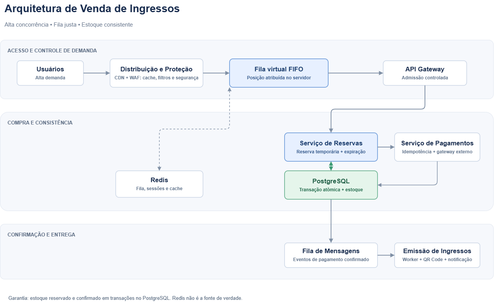

# Sistema de Venda de Ingressos — Arquitetura de Software

Proposta de arquitetura para uma plataforma de venda de ingressos com alta concorrência, inspirada em eventos de grande porte como o Rock in Rio.

## Diagrama de arquitetura

## Objetivos

- Suportar grandes volumes de acessos simultâneos.
- Garantir acesso justo por meio de uma fila virtual.
- Impedir a venda de ingressos acima do estoque disponível.
- Assegurar confiabilidade no processamento de pagamentos.
- Permitir escalabilidade horizontal dos serviços.

## Decisões arquiteturais

**Fila virtual:** controla o acesso à compra por ordem de entrada registrada no servidor, evitando que a velocidade de navegação determine a prioridade.

**Redis:** auxilia no gerenciamento da fila, sessões e dados temporários, reduzindo a carga sobre os serviços principais.

**PostgreSQL:** mantém o estoque como fonte de verdade, utilizando transações atômicas para impedir reservas acima da disponibilidade.

**Reservas temporárias:** os ingressos são reservados por um período limitado. Reservas expiradas são liberadas mediante verificação do estado do pagamento.

**Mensageria:** permite processar notificações e emissão de ingressos de maneira assíncrona, com mecanismos de repetição e idempotência.

**Escalabilidade:** serviços sem estado, balanceamento de carga e escalabilidade horizontal permitem absorver picos de tráfego.

## Fluxo de compra

1. O usuário acessa a plataforma e recebe uma posição na fila virtual.
2. Quando chega sua vez, recebe autorização para iniciar a compra.
3. O sistema verifica o estoque e realiza uma reserva atômica.
4. O usuário efetua o pagamento dentro do prazo estabelecido.
5. Após a confirmação, a compra é concluída e o ingresso é emitido.

## Considerações

A arquitetura prioriza consistência nas operações de estoque e pagamento, enquanto utiliza cache, filas e processamento assíncrono para melhorar desempenho e disponibilidade.
